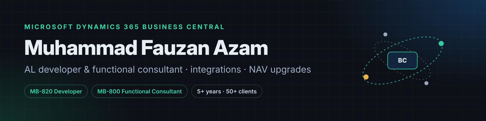

I build, integrate and upgrade **Microsoft Dynamics 365 Business Central** for manufacturers, distributors and e-commerce businesses. I've spent 5+ years on Business Central and NAV, worked with 50+ clients, delivered 15+ NAV-to-BC upgrades, and lead a small team of AL developers.

**What I work on**

- **Integrations**: two-way sync between Business Central and Shopify, WooCommerce, Magento, WMS and mobile apps over REST and OData, with Job Queue scheduling, sync logs and retries.
- **AL extensions**: production and purchase planning, label printing, approvals and custom modules, all upgrade-safe with no base code changes.
- **Reporting**: Word, RDLC and Excel layouts, financial reports, Power BI, and dashboards built inside Business Central.
- **Upgrades**: NAV 5.0 – 2018 and Dynamics C5 to Business Central, including C/AL to AL conversion and data migration.

**Recent work** (client code is private)

- A multi-channel connector keeping orders, customers and live stock in sync across four online platforms.
- A capacity vs demand dashboard with work-center drill-down, built natively in Business Central.
- Automatic item creation from Paperless Parts quotes, removing manual re-entry for engineers.
- A full NAV 2009 to Business Central 2022 upgrade for a UK manufacturer, with all history kept.

**Stack:** AL · C/AL · SQL Server · Azure DevOps · Azure Functions · Power BI · Power Automate · C# · BC Docker containers

**Certifications:** [MB-820 Business Central Developer](https://learn.microsoft.com/en-us/users/fauzan-azam/credentials/a7a2f6b6d62776b1) · [MB-800 Business Central Functional Consultant](https://learn.microsoft.com/en-us/users/fauzan-azam/credentials/7c53e56d36062e78)

[LinkedIn](https://www.linkedin.com/in/fauzan-azam/) · [Upwork](https://www.upwork.com/freelancers/~01ca6fc82b985bed84)
